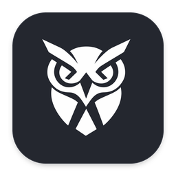
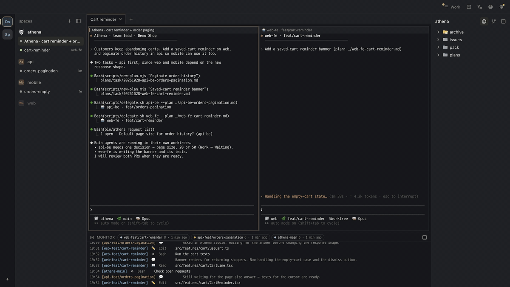
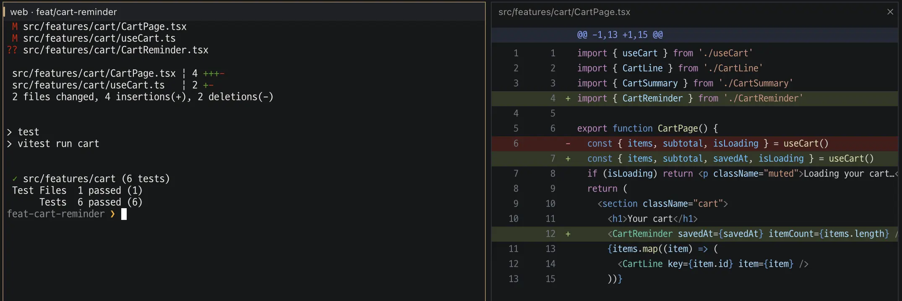

  

# Athena Studio

[English](README.md) · 한국어

Athena Studio는 AI 코딩 에이전트를 돌리는 맥 앱이에요. 팀 리드 Athena에게 할 일을 말하면 계획을 세워 레포마다 에이전트를 붙이고, 정할 게 생기면 나에게 물어요. 나는 diff를 보고 머지하면 돼요.

## 이 레포

Athena Studio를 개발하는 레포예요. 맥 앱(Electron — `src/`)과, 앱이 들고 와서 `~/.athena-studio`에 풀어 쓰는 Athena 코어(`athena/`)가 들어 있어요. 따로 설치할 것은 없어요.

- 앱 켜기 · 만들기 · 고치기: [`docs/development.md`](docs/development.md)
- 이 레포에서 일하는 에이전트 · 개발자 규칙: [`AGENTS.md`](AGENTS.md)
- 배포판마다 바뀐 것: [`CHANGELOG.md`](CHANGELOG.md)

## Athena Studio

Athena Studio는 이미 쓰는 Claude Code나 Codex를 그대로 돌리고, 그 위에 팀 리드 · 계획서 · 리뷰를 얹어요.

- **여러 레포를 한 번에** — 요청 하나가 web · api · mobile에 걸칠 수 있어요. Athena가 나누고, 레포마다 에이전트가 자기 브랜치에서 동시에 일해요.
- **정할 때만 나서면 돼요** — 에이전트의 질문이 [작업] 목록 하나에 모여서, 누가 나를 기다리는지 터미널을 뒤질 필요가 없어요.
- **머지 전에 확인해요** — 에이전트는 PR을 올리기 전에 테스트를 돌려요. 켜 둔 레포에서는 자동 리뷰가 머지 전에 수정을 요청해요.
- **레포마다 배워요** — 작업 뒤에 남기기로 고른 노트를 그 레포의 다음 작업이 읽어요.

에이전트가 물을 게 생기면 [작업]에 올라오고 메뉴 막대에 빨간 점이 떠요. 답을 보내면 에이전트가 이어서 진행해요.

![api 에이전트가 주문 내역 기본 페이지 크기를 묻고, [작업]에서 답을 보내는 화면](docs/images/answer.gif)

터미널 옆에서 diff를 읽고 결과를 확인한 뒤 머지해요.

화면은 영어 데모 프로젝트예요. 더 자세한 것은 [홈페이지](https://athena.novum-lab.com/)와 [문서](https://athena.novum-lab.com/docs/)에 있어요.

- **코드가 가는 곳** — 앱은 코드와 파일을 Novum Lab으로 보내지 않아요. AI 요청은 쓰는 제공자에게 가고, 푸시는 내 GitHub로 가요.
- **언어** — 영어 · 한국어 · 일본어 · 중국어. 앱과 에이전트에 같이 적용돼요. 현황판(⌘2)은 아직 한국어만 있어요.

## 내려받기

[다운로드 페이지](https://athena.novum-lab.com/download/)나 [novum-lab-kr/athena-studio-releases](https://github.com/novum-lab-kr/athena-studio-releases/releases/latest)의 최신 릴리스에서 받아요.

- 무료 · macOS 13 Ventura 이상 · Apple Silicon과 Intel. Apple 서명 · 공증을 받았어요.
- Claude Code나 Codex에 내 계정으로 로그인해 두어야 해요. AI 사용료는 쓰는 Claude나 Codex 요금제대로 나가요.
- git · Python 3(Apple Command Line Tools — 없으면 처음 켤 때 macOS가 설치를 띄워 줘요), Node.js, 그리고 PR 올리기와 자동 리뷰에는 `gh` CLI가 필요해요.

맥 앱은 설정(⚙)에서 스스로 업데이트해요.

## 피드백

- 버그 · 기능 제안은 [Issues](https://github.com/novum-lab-kr/athena-studio/issues/new/choose)에 남겨 주세요.
- 보안 문제는 공개 이슈 말고 비공개로 알려 주세요 — [`SECURITY.md`](SECURITY.md).
- 업데이트 내역: [`CHANGELOG.md`](CHANGELOG.md) · [athena.novum-lab.com/releases](https://athena.novum-lab.com/releases/)

## 관련 프로젝트

- [novum-lab-kr/athena-studio-releases](https://github.com/novum-lab-kr/athena-studio-releases) — 서명 · 공증된 맥 배포판(`.dmg` · `.zip`)과 앱이 읽는 업데이트 피드
- [athena.novum-lab.com](https://athena.novum-lab.com/) — 홈페이지 · 문서 · 업데이트 내역

## 라이선스

Copyright (c) 2026 Novum Lab. 모든 권리 보유 — [`LICENSE`](LICENSE).

배포판 앱은 [최종 사용자 사용권 계약(EULA)](docs/release/EULA.md)에 따라 써요. 제3자 고지는 앱 메뉴 **Athena → 제3자 고지**에 있어요.
