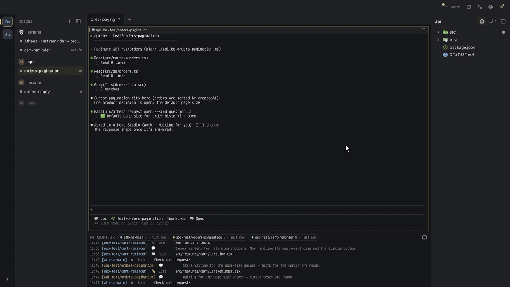

  

# Athena Studio

English · [한국어](README.ko.md)

Athena Studio is a Mac app for running AI coding agents. Tell Athena, the team lead, what you want. It writes a plan, puts an agent on each repository and asks you when something needs deciding. You read the diff and merge.

## The Repository

This repository is where we develop Athena Studio. It holds the Mac app (Electron — `src/`) and the Athena core (`athena/`) that the app brings with it and unpacks into `~/.athena-studio`, so there is nothing else to install.

- Building, running and changing the app: [`docs/development.md`](docs/development.md)
- Rules for agents and developers working in this repository: [`AGENTS.md`](AGENTS.md)
- What changed in each release: [`CHANGELOG.md`](CHANGELOG.md)

## Athena Studio

Athena Studio runs the Claude Code or Codex you already use, and adds a team lead, written plans and reviews on top.

- **Several repositories at once** — one request can touch web, api and mobile. Athena splits it, and an agent works on each repository at the same time, on its own branch.
- **You step in only to decide** — agents bring their questions to one Work list, so you don't scroll through terminals to find who is waiting on you.
- **Checked before it merges** — agents run tests before they open a pull request. In repositories where you turn it on, automatic review asks for fixes before the merge.
- **Learns each repository** — notes you keep after a task are read by the next task in that repository.

When an agent has a question, it shows up in Work and a red dot shows in the menu bar. Send your answer and the agent continues.

Read the diff next to the terminal and check the results before you merge.

The screens are from the English demo project. More on the [homepage](https://athena.novum-lab.com/) and in the [docs](https://athena.novum-lab.com/docs/).

- **Where your code goes** — the app doesn't send your code or files to Novum Lab. AI requests go to the provider you use, and pushes go to your GitHub.
- **Languages** — English, Korean, Japanese or Chinese, for the app and the agents. The work board (⌘2) is in Korean for now.

## Download

Get the app from the [download page](https://athena.novum-lab.com/download/) or the latest release in [novum-lab-kr/athena-studio-releases](https://github.com/novum-lab-kr/athena-studio-releases/releases/latest).

- Free, for macOS 13 Ventura or later, on Apple Silicon and Intel. Signed and notarized by Apple.
- You need Claude Code or Codex, signed in with your own account. AI usage is billed under your Claude or Codex plan.
- git and Python 3 (Apple's Command Line Tools — macOS offers to install them on first launch), Node.js, and the `gh` CLI for pull requests and automatic review.

The Mac app updates itself from Settings (⚙).

## Feedback

- Report a bug or request a feature in [Issues](https://github.com/novum-lab-kr/athena-studio/issues/new/choose).
- Report security problems privately, not in a public issue — see [`SECURITY.md`](SECURITY.md).
- Release notes: [`CHANGELOG.md`](CHANGELOG.md) · [athena.novum-lab.com/releases](https://athena.novum-lab.com/releases/)

## Related Projects

- [novum-lab-kr/athena-studio-releases](https://github.com/novum-lab-kr/athena-studio-releases) — signed and notarized Mac builds (`.dmg` · `.zip`) and the update feed the app reads
- [athena.novum-lab.com](https://athena.novum-lab.com/) — homepage, docs and release notes

## License

Copyright (c) 2026 Novum Lab. All rights reserved — see [`LICENSE`](LICENSE).

The distributed app is licensed under the [End User License Agreement](docs/release/EULA.md). Third-party notices are in the app menu (**Athena → Third-Party Notices**).
