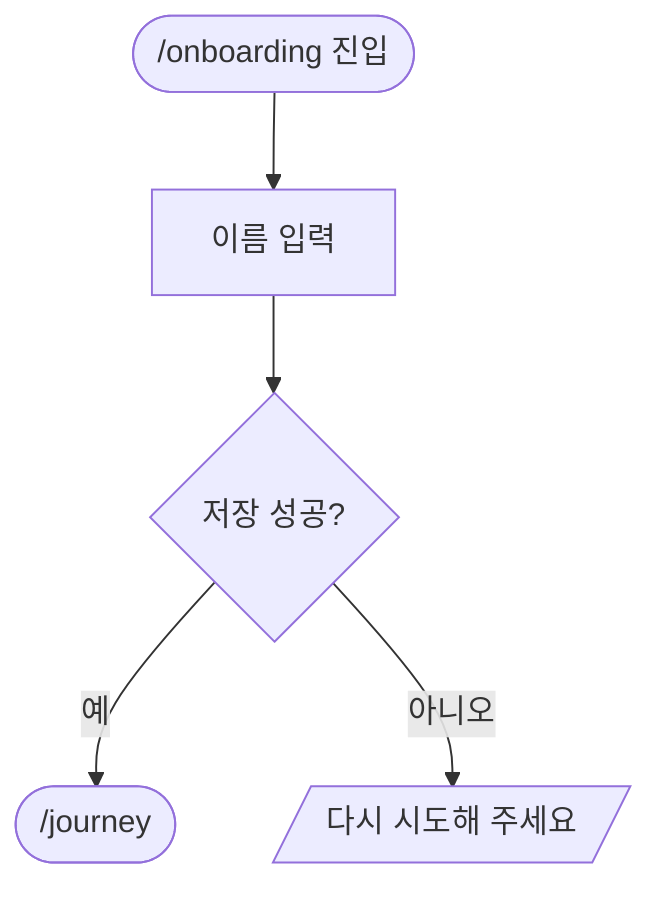

# QA 흐름 문서 · TC 형식 (정본)

서비스 흐름은 그림 도구 없이 **레포 안 문서**로 남기고, 그 분기마다 **TC** 를 둔다. 코드와 같이 PR 로 고친다. 현황판 QA 탭은 이 파일들과 실행 결과만 보여 준다.

**읽을 때**: 흐름 문서 · TC 를 쓰거나 고칠 때 · 실행기(`scripts/qa`)를 고칠 때.

| 층 | 문서 | TC | 실행 |
|---|---|---|---|
| FE | 사용자 흐름 | `.tc.json` | Playwright — 로컬 서버 |
| BE | 요청 흐름(엔드포인트 → 처리 → 응답) | `.tc.json` | HTTP 요청 — 로컬 서버 |
| 앱 | 화면 이동 흐름 + 체크리스트 | 없음 | 없음(사람이 체크리스트로 본다) |

## 자리

```
docs/flows/                     모노레포는 <앱 폴더>/docs/flows (앱 폴더 기본 apps/<앱>)
├─ README.md                    목차 — 층별 흐름 · 무엇을 보나
├─ qa.json                      실행 설정 — 서버 띄우는 법
├─ fe/02-journey.md             흐름 문서
├─ fe/02-journey.tc.json        TC — 문서와 이름이 같다
├─ be/01-auth.md · 01-auth.tc.json
└─ app/01-signup.md             앱은 문서만
```

서비스 = 단일 레포 하나 또는 모노레포 앱 하나. `kind: packages` 는 뺀다. 현황판은 운영 기준 ref(`origin/<branch>`)의 파일을 읽으니 **머지돼야 목록에 뜬다**(머지 전 시험 결과는 문서 링크 없이 보인다).

## 흐름 문서 형식

~~~markdown
# 온보딩 → 저니

## 시작점
어디서 들어오는가 — 경로 · 앞 흐름.

## 흐름도


## 단계
| 단계 | 화면 요소 또는 엔드포인트 | 근거 | 부르는 API | 오류 처리 | 기대 문구 |
|---|---|---|---|---|---|
| 이름 저장 | `[data-testid=name]` · [다음] | `src/pages/onboarding.tsx:42` | `POST /v1/profile` | 500 → 토스트 | "다시 시도해 주세요" |

## 갈림길
- **이름 저장 실패** — 조건과 결과(TC 의 `branch` 가 이 글자를 그대로 쓴다)

## 끝점
어디로 끝나는가.

## 확인 필요
코드로 확정 못 한 것 — 없으면 "없음".
~~~

- **흐름도 표기**: 둥근 칸 시작 · 끝, 네모 화면 · 처리, 마름모 갈림길, 평행사변형 문구. 칸 글은 큰따옴표로 감싼다. GitHub 가 그대로 그린다
- **근거는 꼭 `` `파일:줄` ``** — 레포 기준 경로로 쓴다. `/sync` 가 바뀐 파일을 이 글자와 대조해 고칠 흐름을 찾는다(`scripts/qa/affected.mjs`). 코드에서 확인하지 못한 칸은 비우고 "확인 필요"에 적는다 — 지어내지 않는다
- BE 는 "화면 요소" 칸에 엔드포인트, "기대 문구" 칸에 응답 모양 · 오류 코드를 적는다
- 앱은 맨 끝에 `## 체크리스트` — `- [ ] 무엇을 하면 무엇이 보인다` 줄들. TC 파일을 두지 않는다

## TC 형식

`<흐름>.tc.json` — 공통 칸:

```json
{
  "cases": [
    { "id": "JOURNEY-1", "branch": "이름 저장 실패", "title": "저장이 실패하면 토스트", "...": "층별 칸" },
    { "id": "JOURNEY-2", "branch": "본인인증 통과", "manual": "간편인증이라 자동으로 못 돈다" }
  ]
}
```

- `id` 는 파일 안에서 겹치지 않는다 · `branch` 는 **흐름 문서 본문에 있는 글자**여야 한다(실행기가 검사 — 문서와 TC 가 어긋나면 그 흐름은 오류)
- `manual` 이 있으면 돌리지 않고 "사람 확인"으로 남긴다 — 값에 이유를 쓴다. 로그인 · 결제처럼 자동화가 안 되는 분기에 쓴다. 비밀번호 · 토큰을 TC 에 적지 않는다

**FE** — `steps` 를 차례로. 끝에 콘솔 오류 · 페이지 오류가 있으면 실패(`allowConsole: ["정규식"]` 으로 뺀다). `viewport: "mobile"` 이면 390×844.

| 단계 | 뜻 |
|---|---|
| `{ "mock": "**/v1/profile", "status": 500, "json": {} }` | 그 요청에 가짜 응답 — 그 요청이 나가기 전에 둔다 |
| `{ "goto": "/onboarding" }` | 이동(`/` 로 시작) |
| `{ "click": "selector" }` · `{ "fill": "selector", "value": "글" }` · `{ "press": "Enter" }` | 조작 |
| `{ "expectVisible": "selector" }` · `{ "expectHidden": "selector" }` | 보임 · 안 보임 |
| `{ "expectText": "문구" }` · `{ "expectUrl": "/journey" }` | 문구 · 주소 끝 |

selector 는 Playwright 형식. 데이터를 바꾸는 요청은 `mock` 으로 막는다 — TC 가 실제 데이터를 쓰게 두지 않는다.

**BE** — 요청 하나에 기대 하나.

```json
{
  "id": "AUTH-1", "branch": "토큰 없음", "title": "토큰 없으면 401",
  "request": { "method": "GET", "path": "/v1/me", "headers": {}, "json": null },
  "expect": { "status": 401, "body": { "code": "UNAUTHORIZED" }, "shape": { "message": "string" } }
}
```

- `status` 필수 · `body` 는 적은 값만 비교(부분 일치) · `shape` 는 타입 이름(`string` `number` `boolean` `null` `object` `array`, 배열 안은 `[{ ... }]`)
- `json` 을 안 쓰면 칸을 뺀다. 로그인이 필요한 분기는 지금 `manual`

## 실행 설정 `qa.json`

```json
{
  "fe": { "install": "pnpm install --frozen-lockfile", "start": "pnpm dev", "url": "http://localhost:3000", "ready": "/", "env": {} },
  "be": { "install": "npm ci", "start": "npm run start:test", "url": "http://localhost:4000", "ready": "/health", "readyTimeoutSec": 120 }
}
```

- `url` 은 **로컬만**(`localhost` · `127.0.0.1` · `[::1]`) — dev · 운영 서버에는 돌리지 않는다
- `env` 는 비밀값 아닌 것만. 비밀값은 레포의 `.env*`(기준 트리에 `wt-copy-local.sh` 로 복사된다)
- 그 층 흐름에 TC 가 있는데 설정이 없으면 오류로 보인다

## 실행

```bash
scripts/heavy.sh node scripts/qa/run.mjs --service <서비스>[,<서비스>] | --all [--layer fe|be] [--flow <흐름>]
scripts/heavy.sh node scripts/qa/run.mjs --service <서비스> --cwd <워크트리> [--reuse-server]   # 머지 전 내 브랜치
```

- 기본 대상은 운영 기준 ref 를 받은 `.worktrees/<레포>/qa-base`(커밋이 바뀔 때만 `install`). `--cwd` 는 그 트리를 그대로 쓰고 설치하지 않는다
- 그 주소에 서버가 이미 떠 있으면 다른 코드를 시험할 수 있어 돌리지 않는다 — 내가 띄운 서버면 `--reuse-server`
- 결과는 `.qa-runs/<id>/run.json`(최근 30번 · 서버 로그 같은 폴더 · 오류 원문은 비밀값을 가린다), 끝 코드 0 통과 · 1 문제 있음 · 2 사용법
- 처음 쓸 때 Playwright · Chromium 은 `scripts/setup.sh`
- 현황판 QA 탭 [실행] · `/sync` 확정 뒤(코드가 바뀐 서비스)도 같은 실행기를 부른다

## 쓰는 사람

- `/setup` 5-1 · 새 서비스: 담당 에이전트가 코드를 읽어 흐름 문서 + TC 초안(레포 워크트리에서 · 커밋 · PR 은 사용자 말로)
- `/sync` 3.5: 바뀐 코드에 닿는 흐름의 문서 · TC 를 담당 에이전트가 갱신
- 기능을 고치는 담당 에이전트: 흐름이 달라지면 같은 PR 에서 문서 · TC 도 고친다
