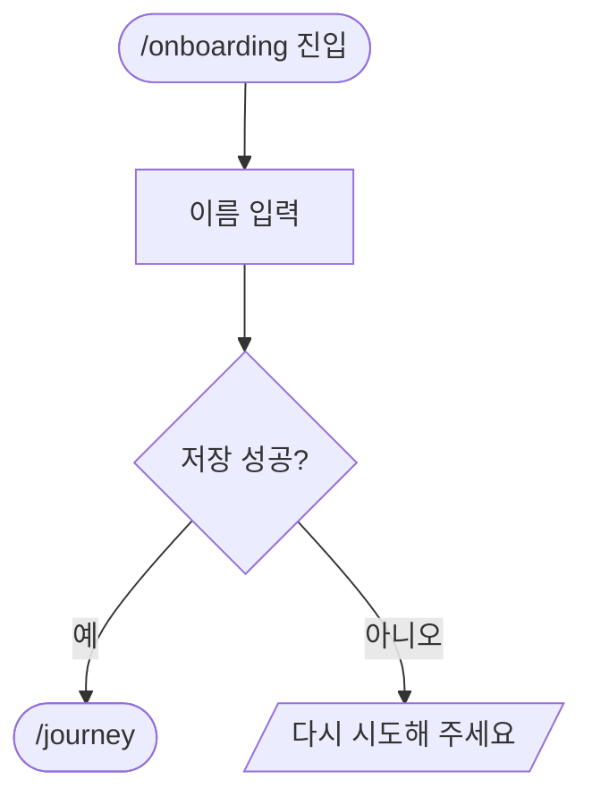

# 서비스 흐름 문서 형식 (정본)

서비스 흐름은 그림 도구 없이 **레포 안 문서**로 남긴다. 코드와 같이 PR 로 고친다.

**읽을 때**: 흐름 문서를 쓰거나 고칠 때.

## 자리

```
docs/flows/                     모노레포는 <앱 폴더>/docs/flows (앱 폴더 기본 apps/<앱>)
├─ README.md                    목차 — 층별 흐름 · 무엇을 보나
├─ fe/02-journey.md             흐름 문서
├─ be/01-auth.md               요청 흐름
└─ app/01-signup.md             앱 흐름과 체크리스트
```

서비스 = 단일 레포 하나 또는 모노레포 앱 하나.

## 흐름 문서 형식

~~~markdown
# 온보딩 → 저니

## 시작점
어디서 들어오는가 — 경로 · 앞 흐름.

## 흐름도


## 단계
| 단계 | 화면 요소 또는 엔드포인트 | 근거 | 부르는 API | 오류 처리 | 기대 문구 |
|---|---|---|---|---|---|
| 이름 저장 | `[data-testid=name]` · [다음] | `src/pages/onboarding.tsx:42` | `POST /v1/profile` | 500 → 토스트 | "다시 시도해 주세요" |

## 갈림길
- **이름 저장 실패** — 조건과 결과

## 끝점
어디로 끝나는가.

## 확인 필요
코드로 확정 못 한 것 — 없으면 "없음".
~~~

- **흐름도 표기**: 둥근 칸 시작 · 끝, 네모 화면 · 처리, 마름모 갈림길, 평행사변형 문구. 칸 글은 큰따옴표로 감싼다. GitHub 가 그대로 그린다
- **근거는 꼭 `` `파일:줄` ``** — 레포 기준 경로로 쓴다. 코드에서 확인하지 못한 칸은 비우고 "확인 필요"에 적는다 — 지어내지 않는다
- BE 는 "화면 요소" 칸에 엔드포인트, "기대 문구" 칸에 응답 모양 · 오류 코드를 적는다
- 앱은 맨 끝에 `## 체크리스트` — `- [ ] 무엇을 하면 무엇이 보인다` 줄들

## 쓰는 사람

- `/setup` 5-1 · 새 서비스: 담당 에이전트가 코드를 읽어 흐름 문서 초안을 쓴다
- `/sync` 3.5: 바뀐 코드에 닿는 흐름 문서를 담당 에이전트가 갱신한다
- 기능을 고치는 담당 에이전트: 흐름이 달라지면 같은 PR 에서 문서도 고친다
